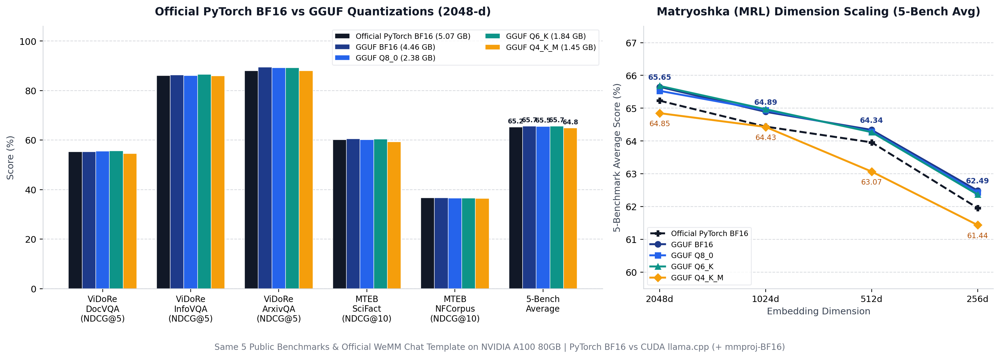

# WeMM-Embedding-2B-GGUF Public Benchmark Report

This report compares **Tencent's Official `WeMM-Embedding-2B` (BF16 PyTorch / Transformers)** against all four **GGUF variants (`BF16`, `Q8_0`, `Q6_K`, `Q4_K_M`, each paired with `mmproj-WeMM-Embedding-2B-BF16.gguf`)** on five standard public retrieval benchmarks spanning **Visual Document Retrieval (MMEB-v2 / ViDoRe)** and **Text Retrieval (MMEB-v3 / MTEB / BEIR)**.

## Evaluation Setup

- **Official Baseline**: `WeChat-Vision/WeMM-Embedding-2B` (`model.safetensors`, BF16, `torch 2.8.0` + `transformers 5.5.3`)
- **GGUF Runtime**: `llama.cpp` (`llama-server`, CUDA `sm_80`, `-ngl 99 -c 16384 -np 4`)
- **Hardware**: NVIDIA A100-SXM4-80GB
- **Prompt Template**: Identical official WeMM chat template (`<|im_start|>user\nRepresent the user's input.\n{input}<|im_end|><embedding>`) with `<embedding>` last-token pooling and L2 normalization.
- **Image Preprocessing**: Identical RGB conversion + `thumbnail((1024, 1024))` across PyTorch and GGUF.
- **Metrics**:
  - **VisDoc (ViDoRe)**: `NDCG@5` (official MMEB-v2 / ViDoRe primary metric) and `R@1`
  - **Text (MTEB / BEIR)**: `NDCG@10` (official MTEB / BEIR primary metric) and `R@1`

> **Scope Note**: These results are measured on 5 representative public datasets under identical prompts and hardware to evaluate GGUF conversion fidelity relative to Tencent's official PyTorch BF16 model. They are **not** the full 78-dataset MMEB-v2 average reported in the upstream paper.

---

## Main Results (2,048-d Full Dimension)

| Model / Variant | Runtime | File Size | Cos vs Official (Text / All) | ViDoRe-DocVQA (NDCG@5) | ViDoRe-InfoVQA (NDCG@5) | ViDoRe-ArxivQA (NDCG@5) | VisDoc Avg | MTEB-SciFact (NDCG@10) | MTEB-NFCorpus (NDCG@10) | Text Avg | **5-Bench Avg** | **vs Official** |
| --- | --- | ---: | ---: | ---: | ---: | ---: | ---: | ---: | ---: | ---: | ---: | ---: |
| **Official BF16** *(ref)* | PyTorch | 5.07 GB | 1.0000 / 1.0000 | 55.31 | 86.10 | 87.97 | 76.46 | 60.12 | 36.63 | 48.38 | **65.23** | **100.00%** |
| **GGUF BF16** | llama.cpp | 4.46 GB | 0.9999 / 0.9920 | 55.34 | 86.26 | 89.50 | 77.03 | 60.47 | 36.66 | 48.57 | **65.65** | **100.64%** |
| **GGUF Q8_0** | llama.cpp | 2.38 GB | 0.9996 / 0.9916 | 55.58 | 86.12 | 89.21 | 76.97 | 60.21 | 36.55 | 48.38 | **65.53** | **100.46%** |
| **GGUF Q6_K** | llama.cpp | 1.84 GB | 0.9984 / 0.9906 | 55.69 | 86.50 | 89.18 | 77.12 | 60.41 | 36.62 | 48.52 | **65.68** | **100.69%** |
| **GGUF Q4_K_M** | llama.cpp | 1.45 GB | 0.9762 / 0.9681 | 54.57 | 85.93 | 87.98 | 76.16 | 59.33 | 36.42 | 47.88 | **64.85** | **99.42%** |

### Key Takeaways

- **Lossless GGUF Conversion**: `GGUF BF16` matches Official PyTorch BF16 text embeddings with **0.9999–1.0000** cosine similarity (and **0.9920** overall across text + image), achieving **100.64%** of the official 5-benchmark average (slight positive gain on ArxivQA comes from `llama.cpp` MTMD vs HF image patch resizing).
- **`Q6_K` (1.84 GB, -64% vs Official)** achieves **100.69%** of Official PyTorch BF16 (**65.68 vs 65.23**) with **0.9984** text cosine similarity — the best quality/size sweet spot.
- **`Q8_0` (2.38 GB, -53% vs Official)** matches Official text vectors at **0.9996** cosine similarity (**100.46%** average score).
- **`Q4_K_M` (1.45 GB, -71% vs Official)** shrinks the model to less than one-third of the official weights while still retaining **99.42%** of Official PyTorch BF16 accuracy (**64.85 vs 65.23**).

---

## Vector Cosine Similarity vs Official PyTorch BF16

| GGUF Variant | Query Text | Corpus Text | Document Image (`mmproj-BF16`) | Overall Mean |
| --- | ---: | ---: | ---: | ---: |
| **GGUF BF16** | 0.99989 | 1.00000 | 0.97340 | **0.99197** |
| **GGUF Q8_0** | 0.99950 | 0.99974 | 0.97301 | **0.99160** |
| **GGUF Q6_K** | 0.99810 | 0.99875 | 0.97249 | **0.99055** |
| **GGUF Q4_K_M** | 0.96941 | 0.98293 | 0.95594 | **0.96807** |

---

## Matryoshka (MRL) Dimension Scaling (5-Benchmark Average)

| Model / Variant | 2048d | 1024d | 512d | 256d | 256d Retention vs 2048d |
| --- | ---: | ---: | ---: | ---: | ---: |
| **Official PyTorch BF16** | 65.23 | 64.44 | 63.96 | 61.96 | 94.99% |
| **GGUF BF16** | 65.65 | 64.89 | 64.34 | 62.49 | 95.19% |
| **GGUF Q8_0** | 65.53 | 64.94 | 64.29 | 62.43 | 95.27% |
| **GGUF Q6_K** | 65.68 | 64.97 | 64.27 | 62.37 | 94.96% |
| **GGUF Q4_K_M** | 64.85 | 64.43 | 63.07 | 61.44 | 94.74% |

---

## Recall@1 Breakdown (2,048-d)

| Model / Variant | ViDoRe-DocVQA | ViDoRe-InfoVQA | ViDoRe-ArxivQA | MTEB-SciFact | MTEB-NFCorpus |
| --- | ---: | ---: | ---: | ---: | ---: |
| **Official PyTorch BF16** | 44.60 | 79.80 | 81.80 | 45.33 | 47.37 |
| **GGUF BF16** | 45.40 | 80.60 | 83.80 | 46.00 | 47.68 |
| **GGUF Q8_0** | 46.20 | 80.40 | 83.00 | 45.00 | 46.75 |
| **GGUF Q6_K** | 46.00 | 81.00 | 83.40 | 46.00 | 47.06 |
| **GGUF Q4_K_M** | 43.60 | 79.40 | 82.00 | 45.33 | 46.13 |
