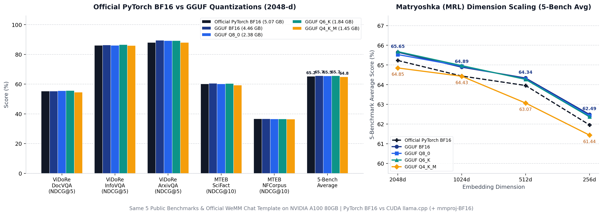

<div align="center">

# WeMM-Embedding-2B-GGUF

<hr>

<p>
  <a href="https://www.modelscope.cn/models/huangyusi/WeMM-Embedding-2B-GGUF">
    
  </a>
  <a href="https://github.com/yu4hhh/WeMM-Embedding-2B-GGUF">
    
  </a>
  <a href="https://github.com/Tencent/WeMM-Embedding">
    
  </a>
  <a href="https://arxiv.org/abs/2608.24053">
    
  </a>
  <a href="./LICENSE">
    
  </a>
  
  
</p>

<p>
  <a href="./README.md">简体中文</a> | <strong>English</strong>
</p>

</div>

GGUF quantized builds of Tencent WeChat Vision Team's universal multimodal embedding model [WeMM-Embedding-2B](https://github.com/Tencent/WeMM-Embedding), optimized for local `llama.cpp` inference with low VRAM and memory footprint.

- **Universal Multimodal Representation**: Supports text, images, videos, visual documents, and interleaved multimodal inputs, outputting 2,048-d L2-normalized embeddings (with Matryoshka truncation to `64 / 128 / 256 / 512 / 1024` dims; audio is not supported).
- **Near-Lossless vs Official PyTorch**: Across 5 public retrieval benchmarks, `GGUF BF16` matches official PyTorch text embeddings at **`0.9999–1.0000`** cosine similarity; `Q6_K` cuts file size by **64%** with virtually zero accuracy loss; `Q4_K_M` cuts size by **71%** while retaining **99.4%** of official accuracy.
- **Ready to Run**: Includes `Q4_K_M`, `Q6_K`, `Q8_0`, and `BF16` weights plus the `BF16` `mmproj` vision projector for image and video embeddings.

> **Notice**: All `.gguf` weight files are hosted on **ModelScope**: [huangyusi/WeMM-Embedding-2B-GGUF](https://www.modelscope.cn/models/huangyusi/WeMM-Embedding-2B-GGUF).

## Files & Recommendations

| File | Size | Accuracy vs Official | Recommended Use |
|---|---:|---:|---|
| `WeMM-Embedding-2B-Q4_K_M.gguf` | 1.56 GB | 99.4% | ⭐ **Default Lightweight**: < 1/3 official size; ideal for consumer GPUs, Mac, or CPU |
| `WeMM-Embedding-2B-Q6_K.gguf` | 1.97 GB | ~100% | ⭐ **Best Quality/Size Sweet Spot**: 64% smaller, virtually lossless (0.9984 text cos sim) |
| `WeMM-Embedding-2B-Q8_0.gguf` | 2.55 GB | ~100% | Accuracy-first quantized version (0.9996 text cos sim) |
| `WeMM-Embedding-2B-BF16.gguf` | 4.79 GB | ~100% | Reference full precision |
| `mmproj-WeMM-Embedding-2B-BF16.gguf` | 671 MB | — | **Required for image / video input** |

> **Tip**: You can quantize the main model freely, while keeping the `BF16` `mmproj` projector for multimodal inference.

## Benchmark (Official PyTorch BF16 vs GGUF)

Evaluated on NVIDIA A100 80GB with the identical official WeMM chat template across **5 standard public retrieval benchmarks** (3 MMEB-v2 VisDoc / ViDoRe datasets + 2 MTEB / BEIR text retrieval datasets):



| Model / Variant | Runtime | Size | Cos vs Official (Text / All) | ViDoRe DocVQA (NDCG@5) | ViDoRe InfoVQA (NDCG@5) | ViDoRe ArxivQA (NDCG@5) | MTEB SciFact (NDCG@10) | MTEB NFCorpus (NDCG@10) | **5-Bench Avg** |
|---|---|---:|---:|---:|---:|---:|---:|---:|---:|
| **Official BF16** *(ref)* | PyTorch | 5.07 GB | 1.0000 / 1.0000 | 55.31 | 86.10 | 87.97 | 60.12 | 36.63 | **65.23** |
| **GGUF BF16** | llama.cpp | 4.46 GB | 0.9999 / 0.9920 | 55.34 | 86.26 | 89.50 | 60.47 | 36.66 | **65.65** |
| **GGUF Q8_0** | llama.cpp | 2.38 GB | 0.9996 / 0.9916 | 55.58 | 86.12 | 89.21 | 60.21 | 36.55 | **65.53** |
| **GGUF Q6_K** | llama.cpp | 1.84 GB | 0.9984 / 0.9906 | 55.69 | 86.50 | 89.18 | 60.41 | 36.62 | **65.68** |
| **GGUF Q4_K_M** | llama.cpp | 1.45 GB | 0.9762 / 0.9681 | 54.57 | 85.93 | 87.98 | 59.33 | 36.42 | **64.85** |

- **Which quant to pick?**: Choose **`Q4_K_M`** (1.45 GiB / 1.56 GB) for tight RAM/VRAM budgets (99.4% retention), or **`Q6_K`** (1.84 GiB / 1.97 GB) for near-zero-loss production retrieval.
- **Matryoshka (MRL) Scaling**: Truncating 2,048-d to **512-d** saves 75% vector storage while retaining **97.3%–98.0%** average accuracy; **256-d** retains ~**95%**.
- **Scope Note**: These are 5 representative public benchmarks measured under identical settings to verify GGUF fidelity (not the full 78-dataset MMEB-v2 average). Slight gains on ArxivQA for `GGUF BF16/Q6_K` stem from minor image resize/patch differences between `llama.cpp` MTMD and HF `Qwen2VLImageProcessor`. See [`BENCHMARK.md`](./BENCHMARK.md) for full details.

## Quick start

Install a recent `llama.cpp` build (Qwen3.5 and multimodal embedding support depend on runtime version).

Download the recommended text model from ModelScope:

```bash
python3 -m pip install -U modelscope
modelscope download \
  --model huangyusi/WeMM-Embedding-2B-GGUF \
  --include 'WeMM-Embedding-2B-Q4_K_M.gguf' \
  --local_dir ./models
```

For image/video support, download the projector as well:

```bash
./scripts/download_modelscope.sh
```

## Text embeddings

```bash
llama-server \
  -m ./models/WeMM-Embedding-2B-Q4_K_M.gguf \
  --embedding \
  --port 8080
```

```bash
curl http://127.0.0.1:8080/v1/embeddings \
  -H 'Content-Type: application/json' \
  -d '{"model":"WeMM-Embedding-2B-Q4_K_M.gguf","input":"multimodal retrieval test"}'
```

The model metadata specifies `qwen35.pooling_type=3` (`last` pooling for the dedicated `<embedding>` token). Do not override it with `--pooling mean`.

## Image and video embeddings

Start the main GGUF and `mmproj` projector together:

```bash
llama-server \
  -m ./models/WeMM-Embedding-2B-Q4_K_M.gguf \
  --mmproj ./models/mmproj-WeMM-Embedding-2B-BF16.gguf \
  --embedding \
  --port 8080
```

Run the included client:

```bash
# Image embedding
python3 examples/llama_cpp_multimodal_embedding.py \
  --image ./image.jpg \
  --output image-embedding.json

# Video embedding (with optional Matryoshka dimension truncation)
python3 examples/llama_cpp_multimodal_embedding.py \
  --video ./video.mp4 \
  --dimension 256
```

Video input requires a `llama.cpp` build with FFmpeg/FFprobe support. Pass `--openai-compatible` to target `/v1/embeddings`.

### Important API note

Do not use the legacy `image_data` + `[img-N]` format; current `llama.cpp` may silently treat it as plain text. Use the runtime-generated `media_marker` from `/props` with a prompt object containing `prompt_string` and `multimodal_data` (handled automatically by `examples/llama_cpp_multimodal_embedding.py`).

## Verification

```bash
sha256sum -c SHA256SUMS
```

## Acknowledgements & Citation

Many thanks to the **WeChat Vision Team at Tencent ([@Tencent](https://github.com/Tencent) / [Tencent/WeMM-Embedding](https://github.com/Tencent/WeMM-Embedding))** for open-sourcing the WeMM-Embedding family, and the [ggml-org/llama.cpp](https://github.com/ggml-org/llama.cpp) community.

```bibtex
@article{wemm-embedding,
  title={WeMM-Embedding: WeChat Multi-Modal Embedding Technical Report},
  author={Junjie Zhou and Ke Mei and Lei Li and Tianyi Wang and Fengyun Rao and Jing Lyu},
  year={2026},
  eprint={2608.24053},
  archivePrefix={arXiv},
  primaryClass={cs.CV},
  url={https://arxiv.org/abs/2608.24053}
}
```

## License

This conversion does not change the upstream **Apache-2.0** license. Please review [LICENSE](./LICENSE) and the [upstream model card](https://www.modelscope.cn/models/Tencent-Hunyuan/WeMM-Embedding-2B) before redistribution.
